# 📊 Awesome-Diagramming-Flowcharts

  

  
  
  
  
  
  

---

## 🌟 Top Diagramming, Flowcharts & Visual Collaboration Ecosystem

> 🎯 **A comprehensive, SEO-optimized curated directory of SaaS platforms, diagrams-as-code engines, open-source canvas libraries, and visual collaboration tools.**  
> *Focused on Code-to-Diagram Generation, Real-Time Multiplayer Collaboration, Architecture Prototyping & Local-First Canvas Editing.*  
> **📅 Last updated: October 2026**

This repository tracks top-tier **cloud SaaS platforms** and **open-source GitHub projects** across the **Diagramming & Flowcharts** ecosystem. Whether you are creating software architecture diagrams from Python/Mermaid/D2 scripts, sketching user flows on an infinite whiteboard, or modeling enterprise BPMN workflows, this list covers verified solutions with transparent pricing, exact free tier limits, and live GitHub_Stars.

---

## 📑 Table of Contents

- [📈 Sector Overview & Market Dynamics](#-sector-overview--market-dynamics)
- [☁️ SaaS & Hosted Platforms](#️-saas--hosted-platforms)
- [💻 Open-Source GitHub Projects](#-open-source-github-projects)
- [🧩 Architecture & Framework Guidelines](#-architecture--framework-guidelines)
- [🤝 How to Contribute](#-how-to-contribute)
- [💖 Support](#-support)
- [📈 Star History](#-star-history)
- [⚖️ Disclaimer](#️-disclaimer)

---

## 📈 Sector Overview & Market Dynamics

The global diagramming and visual collaboration software market is estimated at **$7.5B – $9.2B in 2026** (with standalone diagramming accounting for ~$1.3B–$3.8B and broader enterprise visual collaboration exceeding ~$8B), compounding at an annual growth rate (CAGR) of **11%–14%**. 

Market concentration is **moderately fragmented**: while cloud giants and legacy leaders (Microsoft Visio, Lucidchart, Miro) maintain strong enterprise footprints, the sector is actively contested by high-velocity **code-to-diagram engines (Mermaid, D2, PlantUML)**, **local-first canvas toolkits (Excalidraw, tldraw, draw.io)**, and **AI-agent integrations**, preventing an absolute winner-take-all monopoly and driving innovation across developer-centric workflows.

---

## ☁️ SaaS & Hosted Platforms

A breakdown of leading commercial diagramming and visual collaboration suites, sorted in descending order by **company size / valuation**:

| 🏢 Product | 💰 Company Size (Valuation / Revenue) | 🏷️ Starting Paid Pricing | 🎁 Free Tier / Trial Limits | 📝 Description & Best For |
| :--- | :--- | :--- | :--- | :--- |
| **Microsoft Visio** | ~$3.95 Trillion (Market Cap) | **$5.00 / user / month** (Visio Plan 1, billed annually) | **30-day free trial** (Plan 1/Plan 2; requires business account & payment method); lightweight web viewing/editing included with Microsoft 365 commercial plans | **Enterprise diagramming standard** tightly integrated with Microsoft 365. Fully proprietary and cloud-hosted. Deep integration with Excel data linking, SharePoint, and Microsoft Teams. **Best for**: organizations already committed to the Microsoft enterprise ecosystem. |
| **Lucidchart** | ~$3.0 Billion - $4.5 Billion (Valuation) / ~$144M ARR | **$9.00 / month** (Individual plan, billed annually) | **Free forever plan**: Up to 3 active editable documents, max 60 shapes per document, and 100 basic templates | **The centralized standard for collaborative diagramming**. Fully proprietary and cloud-hosted. Free plan caps documents and shapes. No self-hosting or offline desktop mode. **Best for**: teams prioritizing polished real-time multiplayer collaboration. |
| **Miro** | ~$1.79 Billion (Acquisition Valuation by Bending Spoons) / ~$600M ARR | **$8.00 / member / month** (Starter plan, billed annually, min 2 seats) or $10/mo monthly | **Free forever plan**: Up to 3 active editable boards, unlimited team members (all boards public to workspace), and 10 AI credits/mo | **Collaborative visual whiteboard platform** with diagramming templates and infinite canvas. Fully proprietary and cloud-hosted. **Best for**: cross-functional teams wanting brainstorming, agile retrospectives, and diagramming in one infinite workspace. |
| **SmartDraw** | ~$7 Million - $10.3 Million (Estimated Annual Revenue) | **$9.95 / month** (Individual plan, billed annually at ~$119.40/yr) | **7-day free trial** with full feature access for internal evaluation; no permanent free tier | **Automated diagramming and schematic software** with built-in templates and data-linked visuals. Fully proprietary and cloud-hosted. **Best for**: business and CAD/floor-plan users creating org charts, process diagrams, and schematics. |
| **Creately** | ~$5.1 Million (Estimated Annual Revenue) | **$5.00 / editor / month** (Starter plan, billed annually) or $8/mo monthly | **Free forever plan**: 3 workspaces, capped at 45 items per workspace, 1 folder, and basic export formats | **Visual collaboration and diagramming platform** with specialized frameworks and real-time syncing. Fully proprietary and cloud-hosted. **Best for**: teams wanting a managed visual knowledge base without technical DevOps setup. |

---

## 💻 Open-Source GitHub Projects

Explore the most popular open-source repositories for diagrams-as-code, self-hosted whiteboards, and canvas modeling libraries. **Sorted by GitHub_Stars (descending)**:

| 📦 Project & Repo Link | ⭐ GitHub_Stars | 📜 License | 🎯 Category / Core Strength | 📖 Overview |
| :--- | :--- | :--- | :--- | :--- |
| **[Excalidraw](https://github.com/excalidraw/excalidraw)** |  | MIT | Virtual Hand-Drawn Whiteboard | **Infinite canvas-based virtual whiteboard** with a distinctive hand-drawn aesthetic. End-to-end encryption for real-time collaboration, local-first autosave to browser, and full Docker self-hosting support. |
| **[Mermaid](https://github.com/mermaid-js/mermaid)** |  | MIT | Diagrams-as-Code Standard | **JavaScript-based text-to-diagram generation tool**. Define flowcharts, sequence diagrams, Gantt charts, class diagrams, state diagrams, ER diagrams, and mind maps in Markdown-like syntax. Natively supported across GitHub, GitLab, and Notion. |
| **[draw.io (Desktop)](https://github.com/jgraph/drawio-desktop)** |  | Apache-2.0 | Offline Desktop Diagrammer | **The official desktop application for diagrams.net (draw.io)**. Runs completely offline on Windows, macOS, and Linux without any telemetry or cloud dependency. Full shape libraries for UML, AWS, GCP, network diagrams, and flowcharts. |
| **[tldraw](https://github.com/tldraw/tldraw)** |  | Apache-2.0 / tldraw | Infinite Canvas SDK | **Extensible open-source whiteboard and infinite canvas React library**. Powers modern collaborative drawing experiences, custom shape engines, and real-time multiplayer sketching applications. |
| **[Diagrams (Python)](https://github.com/mingrammer/diagrams)** |  | MIT | Diagram-as-Code (Cloud Architecture) | **Diagram as Code for cloud system architecture**. Draw cloud system architectures using pure Python code. Supports AWS, Azure, GCP, Kubernetes, Alibaba Cloud, and Oracle Cloud without manual drag-and-drop. |
| **[D2](https://github.com/terrastruct/d2)** |  | MPL-2.0 | Modern Declarative Diagramming | **Modern declarative diagramming language** that turns text into diagrams. Features readable syntax, multiple layout engines (TALA, Dagre, ELK), SQL table modeling, auto-formatting, and animated sequence diagrams. |
| **[PlantUML](https://github.com/plantuml/plantuml)** |  | GPL-3.0 | UML & Technical Diagrams | **The classic text-based UML diagramming tool**. Write plain text to render comprehensive UML class, sequence, activity, component, use-case, and deployment diagrams with deep IDE and CI/CD integration. |
| **[Pencil Project](https://github.com/evolus/pencil)** |  | GPL-2.0 | GUI Prototyping & Wireframing | **Standalone diagramming and UI mockup tool**. Features built-in shape collections for desktop and mobile wireframing, multi-page document export, and clickable hyperlink prototyping. |
| **[bpmn-js](https://github.com/bpmn-io/bpmn-js)** |  | Camunda License / Open Source | BPMN 2.0 Process Modeling | **BPMN 2.0 diagramming and web modeling toolkit**. Embeds directly in web applications to view, design, and edit standardized business process diagrams and workflows in pure JavaScript. |
| **[draw.io (Web)](https://github.com/jgraph/drawio)** |  | Apache-2.0 | Web Diagramming Platform | **Source repository for the diagrams.net (draw.io) web client**. Connects directly with Google Drive, OneDrive, Dropbox, and GitHub for completely free, account-less diagram storage. |
| **[OpenFlowKit](https://github.com/openflowkit/openflowkit)** |  | MIT | AI-Native Canvas & MCP Diagrammer | **Free open-source diagram canvas with bidirectional text conversion** (Mermaid, D2, Structurizr), local AI assistant integration (Claude, OpenAI, Ollama), CLI for CI/CD drift detection, and live MCP server support. |

---

### 🛠️ Additional Notable Open-Source Diagramming Tools

- **[Graphviz](https://graphviz.org/)** — **The DOT language standard** (EPL): Define graphs and networks programmatically in DOT syntax and render using automatic graph layout engines (`dot`, `neato`, `circo`, `twopi`).
- **[LibreOffice Draw](https://www.libreoffice.org/discover/draw/)** — **Offline office vector diagrammer** (MPL-2.0): Full-featured vector graphics and flowchart tool integrated into the LibreOffice suite.
- **[Dia](http://dia-installer.de/)** — **Lightweight legacy diagram editor** (GPL-2.0): Classic modular flowcharting program with XML-based custom shape support for low-spec workstations.
- **DocuShark** — **Document editor with built-in canvas and MCP server** (AGPL-3.0): Blends Markdown prose with real-time CRDT diagramming and AI agent reading/writing access.
- **Agentic Mermaid** — **Mermaid rendering engine for autonomous AI agents**: Generates styled SVGs, PNGs, ASCII, and Unicode art with custom themes for automated documentation pipelines.

---

## 🧩 Architecture & Framework Guidelines

When designing and documenting systems, consider the fundamental trade-offs between **canvas-based** and **code-based** diagramming:

1. **Canvas Tools (draw.io, Excalidraw, tldraw)**:
   - *Best for*: Brainstorming, user journeys, initial wireframes, and design sprints.
   - *Trade-off*: Diagrams are stored as JSON/XML binaries that are harder to review in Git pull request diffs.
2. **Diagrams-as-Code (Mermaid, D2, PlantUML, Diagrams Python)**:
   - *Best for*: Living system architectures, CI/CD pipeline automation, and developer READMEs.
   - *Trade-off*: Automatic layouts lack pixel-perfect manual positioning, but diffs are instantly readable in version control.
3. **Local-First & Data Sovereignty**:
   - For sensitive enterprise architectures, tools supporting 100% offline usage (draw.io Desktop, Excalidraw Docker, PlantUML CLI) ensure sensitive topology never leaves your boundary.

---

## 🤝 How to Contribute

Contributions are warmly welcomed! Help make this ecosystem guide the definitive resource for developers:

1. 🍴 **Fork the repo** to your GitHub account.
2. 🌿 **Create a descriptive branch** (`git checkout -b feature/add-new-diagram-tool`).
3. ✏️ **Add/edit entries in `README.md`** following the established table structure with links, license, and Stars_Badges.
4. 🚀 **Submit a Pull Request** with a concise explanation of why the tool should be listed.

---

## 💖 Support

If you find this curated diagramming & flowchart repository helpful:
- ⭐ **Star this repository** to show your support and help others discover it!
- 🍴 **Fork & Share** it with your fellow developers, system architects, and tech communities.
- ☕ **Buy me a coffee / Sponsor**: Support ongoing maintenance and curation via the [GitHub Sponsors Dashboard](https://github.com/sponsors/ishandutta2007).

---

## 📈 Star History

---

## ⚖️ Disclaimer

- This list is a community-curated resource for informational purposes only and does not constitute an official endorsement.
- All product names, logos, trademarks, and registered trademarks belong to their respective owners.
- SaaS pricing, terms, and feature sets change periodically; verify active pricing on the respective vendors' websites before purchase.

---

  <b>Built with ❤️ for developers, software architects, and open-source creators worldwide.</b> 
  <i>Let's keep diagramming open, code-first, and beautifully visualized.</i>

